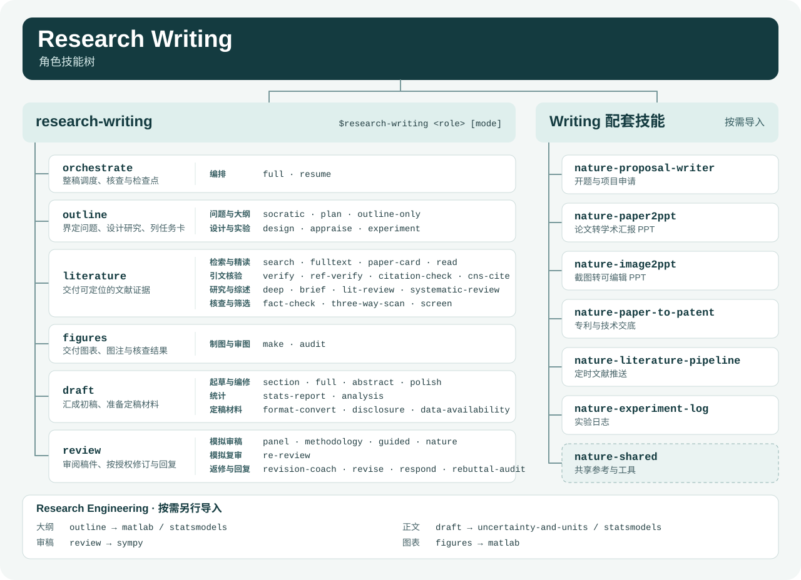
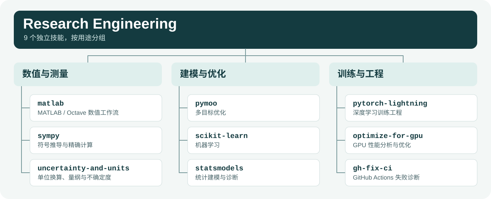
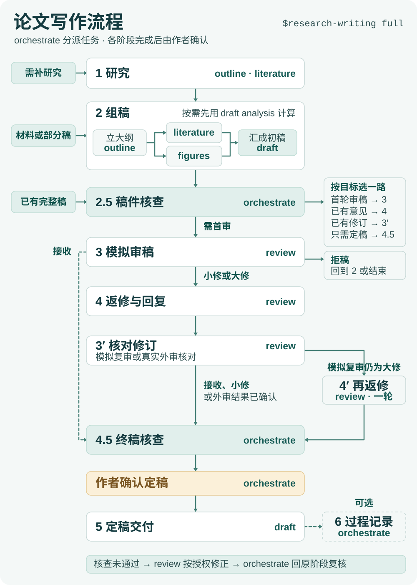

# Research Skills Pack

English | [中文](README.zh.md)

Use these agent skills to take a paper from research question to revision, check a figure against its source data, or run a scientific calculation on its own.

[The two packs](#the-two-packs) · [Deployment](#deployment) · [Usage examples](#usage-examples)

## The two packs

### Research Writing

The pack has eight directories. The core `research-writing` skill brings together six roles (`orchestrate`, `outline`, `literature`, `figures`, `draft`, and `review`). Six standalone Nature workflows cover proposals, presentations from papers, editable slides from images, patents, literature feeds, and experiment logs. The eighth directory, `nature-shared`, holds references used by `nature-paper2ppt`. [Writing skill list](skills/research-writing/README.md)

<p align="center">
  <a href="doc/figures/writing-skill-tree.svg">
    
  </a>
</p>

### Research Engineering

Choose from nine independent skills for MATLAB/Octave, SymPy, measurement uncertainty, GPU optimisation, multi-objective optimisation, scikit-learn, PyTorch Lightning, statsmodels, and GitHub Actions diagnostics. [Engineering skill list](skills/research-engineering/README.md)

<p align="center">
  <a href="doc/figures/engineering-skill-tree.svg">
    
  </a>
</p>

## Deployment

Install each skill as a directory in your agent's project or user skills location. For hosts that use the `.agents/skills/` layout, the writing entry point is `<project>/.agents/skills/research-writing/SKILL.md` for one project or `~/.agents/skills/research-writing/SKILL.md` across projects.

Copy this prompt into your agent. It installs both packs for the current project by default. For a smaller installation, name the skills you need. To share them across projects, replace “current project” with “current user”.

```text
Import both Research Skills packs for the current project.
Use a local checkout if I provide one, otherwise use
https://github.com/AmazingUmi/Research-Skills-Pack.

Use this agent host’s skills directory for the requested scope. From
skills/research-writing/skills/ and skills/research-engineering/skills/,
copy each selected directory intact, including SKILL.md, NOTICE and licenses.
Keep research-writing together as one skill. Include nature-shared when
importing nature-paper2ppt. Skip generated Python and test caches.
Check for same-name conflicts and ask me before replacing existing files.
Verify each installed SKILL.md is readable. Report the paths and skill names.
```

For a trial without installing, ask the agent to read the target `SKILL.md` in your checkout and follow it. Give it access to the whole skill directory and any required sibling skill. [Writing entry point](skills/research-writing/skills/research-writing/SKILL.md) · [Engineering skill list](skills/research-engineering/README.md)

## Usage examples

**Take a paper through the workflow.** `$research-writing full` starts `orchestrate full`. Attach your materials and ask for a stage plan. With a research question alone, the workflow usually starts at Stage 1. With an approved outline and results, you can choose a later starting point and an author checkpoint. [Stages and entry points](skills/research-writing/skills/research-writing/roles/orchestrate/ROLE.md)

```text
$research-writing full
Start at Stage 2. Use the attached outline, results, citations and figures.
Deliver the full draft, a citation and figure index, and unresolved questions.
Stop at the Stage 2 author checkpoint.
```

<p align="center">
  <a href="doc/figures/paper-workflow.svg">
    
  </a>
</p>

**Respond to journal reviewers.** Attach the submitted manuscript, decision letter and numbered comments. A new run checks the submitted version at Stage 2.5 before revision at Stage 4. [External review workflow](skills/research-writing/skills/research-writing/roles/orchestrate/references/external_review_protocol.md)

```text
$research-writing full
Keep the reviewers’ numbering and give me a revision plan for approval.
After I confirm the changes, revise the manuscript and draft the response
letter. Check each reply against the revised text.
```

**Call one role directly.** Use `$research-writing <role> [mode]` with the relevant source files. [All writing modes](skills/research-writing/skills/research-writing/references/skill-map.md)

| Command | Request |
| --- | --- |
| `$research-writing outline` | Map the claims and evidence to sections. |
| `$research-writing literature verify` | Locate the passage supporting this citation and check its scope. |
| `$research-writing figures audit` | Check the plotted values, units and error bars against the table. |
| `$research-writing draft full` | Write a complete first draft from my approved outline and evidence. |
| `$research-writing review panel` | Show me the proposed reviewers before simulating peer review. |

**Prepare a lab talk.** `$nature-paper2ppt` Turn the attached paper into a 10-minute Chinese presentation. Use the original figures and write speaker notes for each slide.

**Check a calculation.** `$uncertainty-and-units` Combine independent standard uncertainties of 0.10 mm and 100 µm. Both sensitivity coefficients are 1. Show the conversion and report the combined standard uncertainty in millimetres. The root-sum-of-squares result is about **0.1414 mm**. [Uncertainty and units](skills/research-engineering/skills/uncertainty-and-units/SKILL.md)

**Pause or resume.** Use `$research-writing orchestrate resume` to continue a paused run from its recorded checkpoint. Default integrity checks run in the conversation. Strict mode uses Python 3 and the engine dependencies. For a cross-session handoff, enable `RW_PASSPORT_RESET=1` in strict mode before the checkpoint. In the next session, supply the same Material Passport and `resume_from_passport=<hash>` using the emitted checkpoint hash. [Engine requirements](skills/research-writing/skills/research-writing/engine/requirements.txt) · [Resume protocol](skills/research-writing/skills/research-writing/roles/orchestrate/strict/passport_as_reset_boundary.md)

## License

Repository-authored documentation uses Apache-2.0. The integrated `research-writing` skill uses CC BY-NC 4.0 for non-commercial use. When redistributing skills, include their licenses, notices and corresponding source entries. [Repository license](LICENSE) · [Component licenses and attribution](skills/SOURCES.md)
