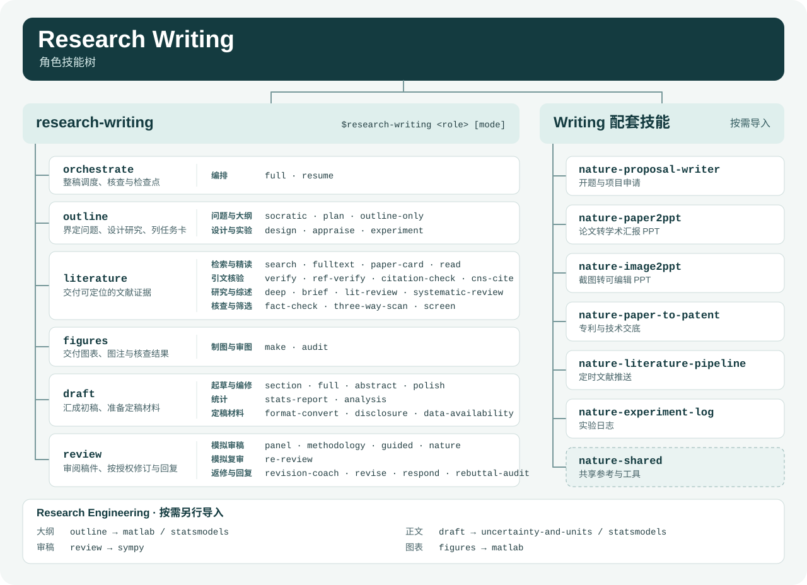
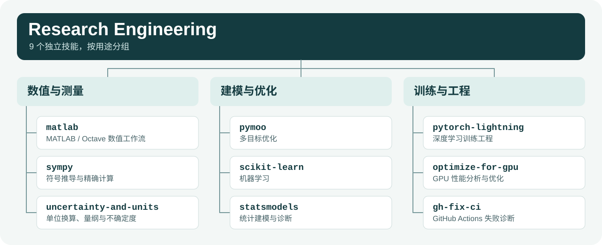
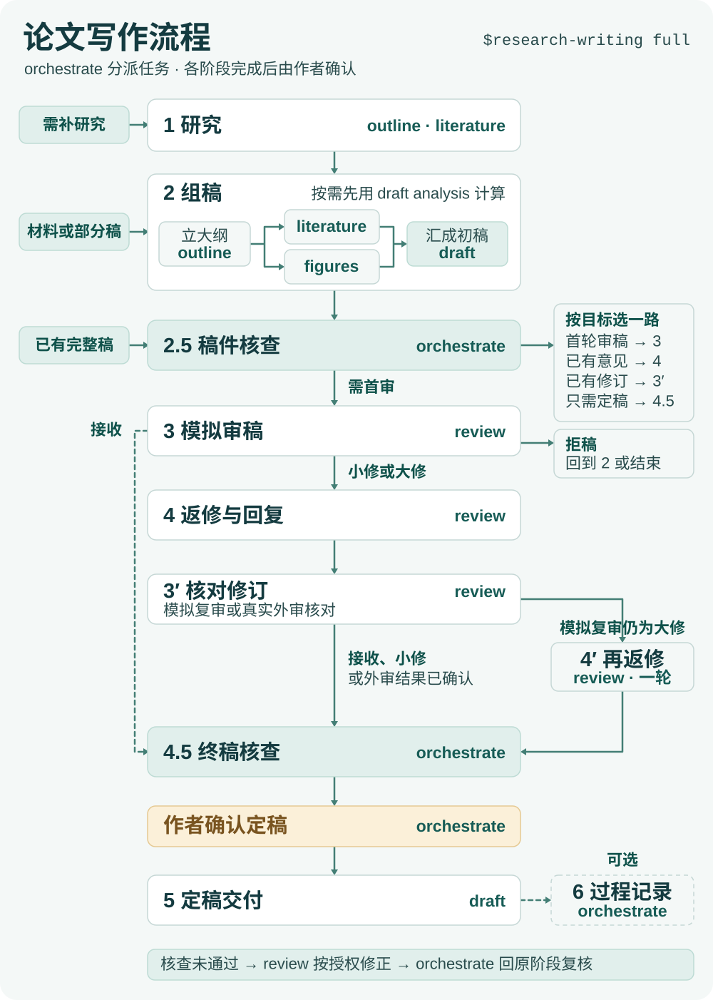

# Research-Skills-Pack · 科研技能包

[English](README.md) | 中文

用 **Research Writing** 把研究材料整理成论文、核查引文或处理外审意见。用 **Research Engineering** 做数值计算、统计建模和科研软件开发。两个包可分别部署，也可以配合使用，例如先核算测量不确定度，再把结果和单位交给写作流程。

[两个技能包](#两个技能包) · [部署](#部署) · [使用示例](#使用示例)

## 两个技能包

### Research Writing · 科研写作

论文写作从 `research-writing` 进入。它有编排、大纲、文献、图表、正文、审稿六个角色，可以推进整篇论文，也可以只请文献角色核对引文，或请图表角色审查误差棒。[写作入口](skills/research-writing/skills/research-writing/SKILL.md) · [角色与模式](skills/research-writing/skills/research-writing/references/skill-map.md)

写作包另有 6 个配套工作流，分别用于开题报告、论文转 PPT、截图转可编辑 PPT、专利材料、文献推送和实验日志。加上共享参考目录 `nature-shared`，共 8 个可安装目录。[配套技能清单](skills/research-writing/README.md#独立技能)

<p align="center">
  <a href="doc/figures/writing-skill-tree.svg">
    
  </a>
</p>

### Research Engineering · 科研工程

9 个独立技能覆盖 MATLAB/Octave、符号推导、单位与不确定度、GPU 优化、多目标优化、机器学习、深度学习训练、统计建模和 GitHub Actions 诊断。可按项目选择，例如用 `sympy` 推导公式，用 `statsmodels` 拟合统计模型。[工程技能与用途](skills/research-engineering/README.md)

<p align="center">
  <a href="doc/figures/engineering-skill-tree.svg">
    
  </a>
</p>

## 部署

从 `skills/research-writing/skills/` 或 `skills/research-engineering/skills/` 中选取所需技能，把**含有 `SKILL.md` 的整个目录**复制到 Agent 的技能目录。项目级安装仅供当前项目使用，用户级安装可跨项目使用。以采用 `.agents/skills/` 布局的宿主为例，项目级写作入口应位于 `<项目>/.agents/skills/research-writing/SKILL.md`，用户级则位于 `~/.agents/skills/research-writing/SKILL.md`。

整稿流程只需安装 `research-writing`，六个角色随目录一并提供。单独安装 `nature-paper2ppt` 时，一并安装同级的 `nature-shared`。只想试用时，也可以让 Agent 直接读取仓库中目标技能的 `SKILL.md`，并让它访问同一目录内的脚本、模板和参考资料。

**交给 Agent 部署**时可直接复制下面的提示词。按需将“当前项目”改为“当前用户的全局技能目录”，或把仓库地址换成本地路径。

```text
请从 https://github.com/AmazingUmi/Research-Skills-Pack 把写作包和工程包部署到当前项目的技能目录。
按当前宿主的目录约定，逐个复制两个包 skills/ 下含 SKILL.md 的完整目录，保留原名、NOTICE 和许可证，排除生成的缓存。
如果我指定了技能名称，只复制所选技能及其必需的共享目录。遇到同名目录先询问我。
完成后列出实际安装路径和技能名称，并核对每个 SKILL.md 均可读取。
```

## 使用示例

### 从研究材料组稿

```text
$research-writing full
附件是已确认的大纲、实验结果表、引文表和三张图。从阶段 2 开始，复用已有材料。
请交付全文初稿、引文与图件索引，列出证据不足的主张，然后停在作者检查点。
```

`$research-writing full` 是 `$research-writing orchestrate full` 的简写。只有研究问题时可从阶段 1 开始。阶段 2 由大纲角色核对主张和证据，按需补文献、统计或图表，再由正文角色汇稿。只想起草全文时，直接用 `$research-writing draft full`。流程暂停后，用 `$research-writing orchestrate resume` 核对稿件版本和未决事项，接着上次的检查点继续。[阶段与入口说明](skills/research-writing/skills/research-writing/roles/orchestrate/ROLE.md)

<p align="center">
  <a href="doc/figures/paper-workflow.svg">
    
  </a>
</p>

### 按真实外审意见返修

```text
$research-writing full
附件是送审稿、编辑信和两位审稿人的意见。请保留原编号，先交逐条返修计划。
等我确认修改范围后，再写修订稿和回复信，并说明每条意见对应的实际改动。
```

新流程先对送审稿做阶段 2.5 完整性核查，再进入阶段 4 返修。复审时对照新旧稿和回复信逐项核对。[外审返修流程](skills/research-writing/skills/research-writing/roles/orchestrate/references/external_review_protocol.md)

### 完成一个具体任务

写作角色的调用格式为 `$research-writing <角色> [模式]`。下面每行都是可以单独发送的请求。

| 任务 | 示例 |
| --- | --- |
| 拟定大纲 | `$research-writing outline` 根据研究问题和结果表给出章节计划，列出每项主张对应的证据。 |
| 核对引文 | `$research-writing literature verify` 对照附件原文，判断标出的句子是否有引文支持，给出原文位置和适用范围。 |
| 审查图表 | `$research-writing figures audit` 对照源数据表检查图 2 的数值、单位、误差棒和图注。 |
| 模拟审稿 | `$research-writing review panel` 审阅附件稿件，先给我确认审稿人卡片。 |
| 准备组会 | `$nature-paper2ppt` 把附件论文整理成 10 分钟的中文汇报，保留关键原图并附逐页讲稿。 |
| 核算不确定度 | `$uncertainty-and-units` 两个独立的标准不确定度分量为 0.10 mm 和 100 µm，灵敏系数均为 1。请统一为 mm，列出预算表并计算合成标准不确定度。 |

最后一例中，100 µm 等于 0.10 mm，两个独立分量按平方和开根号合成，结果约为 **0.1414 mm**。

**需要可复核的交接记录时**，可在 `$research-writing full` 后写明“启用严格模式并保存 Material Passport”。默认完整性核查在会话中用证据矩阵记录主张和出处。严格模式使用 Python 3 和配套校验库。[引擎依赖清单](skills/research-writing/skills/research-writing/engine/requirements.txt)

若需跨会话恢复，先在严格模式下启用 `RW_PASSPORT_RESET=1`。生成断点后，在新会话读取同一份 Passport，并发送 `resume_from_passport=<hash>`，将占位符换成断点给出的 12 位十六进制哈希。恢复时沿用断点记录的下一阶段，有待决分支时由作者先选定。协议列出了可用的 `stage=` 和 `mode=` 参数。[断点接续协议](skills/research-writing/skills/research-writing/roles/orchestrate/strict/passport_as_reset_boundary.md)

## 许可证与来源

仓库原创文档采用 Apache-2.0。核心 `research-writing` 因含 ARS 改编内容，按 CC BY-NC 4.0（限非商业用途）分发。其他技能各自保留组件许可。再分发时请保留相应许可证、声明及来源条目。[仓库许可证](LICENSE) · [组件来源与许可](skills/SOURCES.md)
