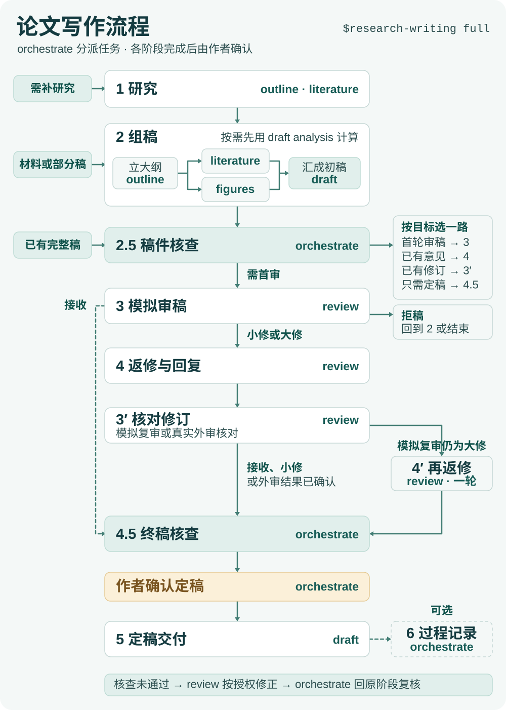
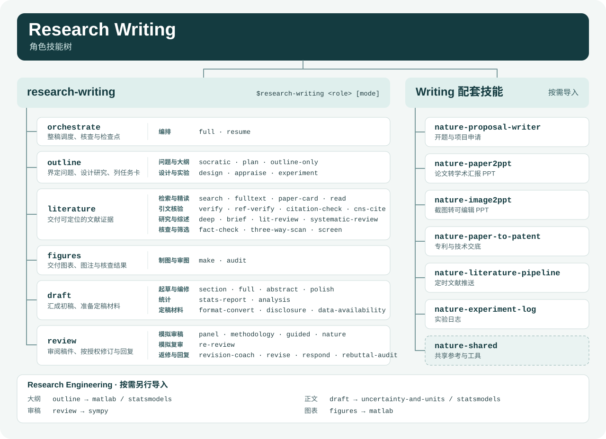
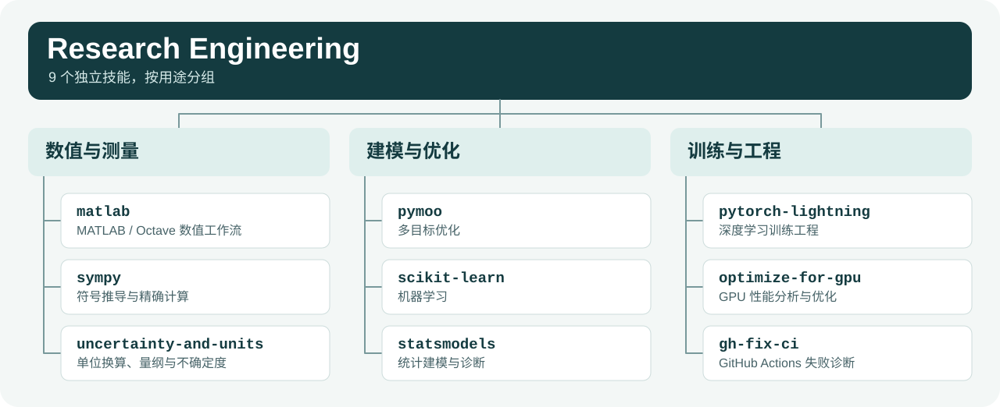

# 科研技能包使用指南

**Research Writing** 用于论文研究、组稿、核查、审稿和返修。**Research Engineering** 提供科研编程和计算技能，可单独使用，也可给写作流程提供经核对的计算结果。

## 导入或直接使用

- **导入技能。** 从相应包的 `skills/` 下选择技能，把包含 `SKILL.md` 的整个目录复制到 Agent 支持的技能目录。整稿只需导入 `research-writing`，其六个角色和对应模式都在同一目录内。工程技能按需独立导入。
- **直接读取。** 让 Agent 读取仓库里的目标 `SKILL.md` 并按其执行，确保它可以访问该技能的整个目录。适合先试用单个任务。可从[写作入口](../skills/research-writing/skills/research-writing/SKILL.md)或[工程技能列表](../skills/research-engineering/README.md)找到入口。

## 用 Research Writing 推进一篇论文



### 从研究到定稿

```text
$research-writing full
我想把附件中的研究问题、方法记录、结果表和文献整理成一篇论文。
请根据已有材料选入口，给我看阶段安排，再按检查点推进到定稿。
```

`$research-writing full` 等同于 `$research-writing orchestrate full`。只有选题时通常从阶段 1 开始，材料齐备、还未成稿时从阶段 2 组稿。有稿件再开启整稿流程时，先对提供的版本做阶段 2.5 完整性核查，再按目标进入初审、返修、复审或终稿核查。各阶段完成后由作者确认，模拟审稿还会先展示审稿人卡片。见[阶段和入口说明](../skills/research-writing/skills/research-writing/roles/orchestrate/ROLE.md)。

### 先把全文写出来，在组稿检查点停下

```text
$research-writing full
研究已完成。附件是已确认的大纲、实证结果表、引文表和三张已验收的图。
从阶段 2 开始，复用已有材料，只补影响写作的缺项。
交付全文初稿、引用与图件索引、待核事项。停在阶段 2 结束后的作者检查点。
```

用 `$research-writing full` 开新流程时，可以在请求正文里指定起始阶段和暂停检查点。`stage=` 用于下文的 Passport 断点接续。

阶段 2 由 `outline` 先核对大纲和证据任务，再按缺项调用 `literature` 和 `figures`。两个分支的输入独立时可以并行。已有的引文、图件和其他材料核对后直接复用，最后由 `draft` 写入并汇总初稿。

确认初稿后，可在同一对话回复「阶段 2 的初稿已确认，请进入 2.5」。此前已暂停时，用 `$research-writing orchestrate resume` 恢复同一次流程的记录，核对稿件版本和未决检查点后再继续。要单独写完初稿，直接用 `$research-writing draft full` 即可。

### 已有稿件和真实外审意见

```text
$research-writing full
这是送审稿和期刊发来的编辑信、审稿意见。请先核查这版稿件，再进入返修。
保留审稿意见编号，先交返修路线图。等我逐项确认改动范围后，再写修订稿和回复信。
```

新流程先做 `2.5 → 4`。已有核查报告可作参考。同一次流程已完成阶段 2.5 且核查结论仍适用于当前稿件时，可从有效断点接续。阶段 4 由 `review revise` 写入修订候选，`review respond` 根据实际改动写回复。阶段 3′ 对照外审意见、新旧稿和回复信逐项核对，作者确认后进入 4.5 终稿核查。见[真实外审流程](../skills/research-writing/skills/research-writing/roles/orchestrate/references/external_review_protocol.md)。

## 只调用一个角色或模式



调用格式为 `$research-writing <角色> [模式]`。只写角色时，Agent 按该角色的说明选择模式或执行默认流程。整稿才用 `orchestrate`，边界清楚的单项任务可直接点名角色。

| 想完成的任务 | 可以直接发给 Agent 的请求 |
| --- | --- |
| 用已有材料整理大纲 | `$research-writing outline` 根据附件里的研究问题和结果，给我章节计划、主张与证据表以及引文和图件任务。 |
| 核对一条引文 | `$research-writing literature verify` 核对这条引文是否支持标出的句子，给出原文位置与适用范围。 |
| 检查一张图 | `$research-writing figures audit` 用源数据表核对这张图的数值、单位、误差棒和图注。 |
| 单独起草全文 | `$research-writing draft full` 按已确认的大纲、证据、引文和图件写整篇初稿。 |
| 模拟同行评审 | `$research-writing review panel` 审阅附件稿件，先给我确认审稿人卡片。 |

研究问题尚未成形时用 `outline socratic`，需要逐章讨论时用 `outline plan`，只要详细大纲和证据地图时用 `outline outline-only`。只写一节用 `draft section`。全部模式见[能力清单](../skills/research-writing/skills/research-writing/references/skill-map.md)。

## 默认核查和严格模式

- **默认。** 编排的两次完整性核查使用证据矩阵，记录主张、来源位置、适用范围和核验状态。这条核查路径可在会话中完成，无需安装 Python 引擎。各专项模式的独立工具需求见其说明。
- **严格。** 需要 Material Passport、机器校验或可复核的稿件交接时，可发「`$research-writing full`，请启用严格模式，保存可复核的核查和交接记录。」脚本需要 Python 3 和[依赖清单](../skills/research-writing/skills/research-writing/engine/requirements.txt)所列的库。
- **从 Passport 跨会话接续。** 上一会话须已在严格模式下启用 `RW_PASSPORT_RESET=1`，并生成有效的 `[PASSPORT-RESET: ...]` 断点。新会话读取同一份 Passport，使用实际断点哈希提交 `resume_from_passport=<hash>`。`stage=` 是这种恢复的可选阶段覆盖参数，仍要处理任何未决的作者确认。见[断点重置与接续协议](../skills/research-writing/skills/research-writing/roles/orchestrate/strict/passport_as_reset_boundary.md)。

## Engineering 与独立配套技能



Research Engineering 的每个技能都可独立调用。例如导入 [`uncertainty-and-units`](../skills/research-engineering/skills/uncertainty-and-units/SKILL.md) 后，可以发「`$uncertainty-and-units`，用附件中的量值、单位和不确定度预算核算合成标准不确定度，说明独立性假设与报告精度。」结果可作为 `outline`、`figures` 或 `draft` 的证据材料。工程技能也覆盖 MATLAB/Octave、符号推导、优化、机器学习、统计模型和 GitHub Actions 诊断。见[工程技能列表](../skills/research-engineering/README.md)。

开题、学术汇报 PPT、截图转 PPT、专利材料、定时文献推送和实验日志都有独立入口。按需导入对应的 Nature 技能，依其说明配好 `nature-shared` 等引用资源。见[写作包的独立技能列表](../skills/research-writing/README.md#独立技能)。
