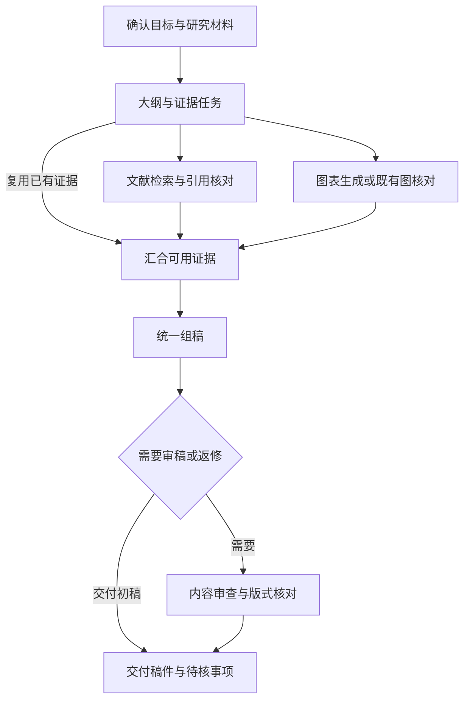

# PaperOrchestra 科研写作流程指南

本组将 PaperOrchestra 的角色、工序和产物交接改成可按任务选择的工作流。适用于定量研究、质性和文本研究、理论论文以及综述。可以从研究材料开始组稿，也可以从已有稿件、图表或某条审稿意见进入。

## 1. 原项目到本组的对应关系

原项目由 Python 调度器控制整篇论文的执行顺序。大纲以 JSON 保存计划。自动制图开启时，文献与制图同时读取初始大纲，完成后将引文、图件和更新大纲交给一次全文写作调用。随后在独立工作目录编译草稿、审稿与精修。关闭自动制图时，程序使用已有图件。论文写作的五个阶段都保留在本组，单次调用按任务选择入口。

| 环节 | 原项目的主要交付 | 本组的实际操作 |
| --- | --- | --- |
| 大纲 | `outline.json` 包含出图、检索和章节计划 | 输出可供下游执行的大纲、主张清单、检索和出图任务卡 |
| 文献 | `citation_map.json`、`references.bib`、前两节模板、回填引文后的大纲 | 按任务交付证据表、引文库、引言或相关工作。对每条主张标注支持范围 |
| 图表 | `plotting_results.json`、栅格图及 `figures/info.json` | 按任务交付图件、图注、来源及生成依据，或核对已有图件 |
| 正文 | 读取前两节、引文库和图后生成 `raw_draft_paper.tex` | 统一整合指定章节或全文，围绕真实来源做交叉引用和数字核查 |
| 审稿返修 | 初稿 PDF、内容候选、审稿评分、排版候选、最终 TeX/PDF | 单独审阅、答复或返修。在授权改稿时比较候选与基线，用可核查证据决定采纳 |

原实现的内容精修最多三轮。每版默认经过三份模拟审稿及一次汇总，按总分和并列时的分项变化选择版本，之后还有独立的视觉版式检查。本组以用户目标决定是否迭代。核查时优先判断证据和推理能否支持论断，再看表述与版式。[论文 §4][paper] · [并行调度][writer] · [精修源码][refinement] · [模拟审稿][reviewmodel]

## 2. 先按手头材料选择入口

| 手上有 | 这次要 | 走法 |
| --- | --- | --- |
| 初步研究想法，材料尚不齐 | 找到论文主线、决定补什么 | 只调用大纲。将已知、待验证判断和需补证据分别标出 |
| 研究问题和核心材料齐备，暂无稿件 | 形成整篇初稿 | 大纲 → 按需选文献或图表分支 → 正文。若还要审稿再进入精修 |
| 已确认大纲与用于论证的材料 | 只写指定章节或出一张图 | 章节交正文角色。图与图注交图表角色。已有大纲作输入 |
| 已有整稿或某节初稿 | 核对数字、比较口径、引文和图件 | 直接审稿，需要原文证据时让文献角色补核 |
| 外审意见和当前稿件 | 写逐条答复，或按意见返修 | 直接审稿返修。由用户请求决定交付回复、建议还是实际修改 |

准备材料时，优先指出**本次任务，以及哪份材料能支撑它**。整篇组稿需要研究问题、核心依据和稿件要求。定量研究可提供数据、结果表与分析记录，质性或文本研究可提供访谈、语料、档案或分析备忘，理论研究可提供定义、前提、推导及待核引理。已有图件和参考文献可复用。单角色任务按实际需要取材。

## 3. 完整组稿怎么一路执行

| 阶段 | 执行动作 | 可以交给下一阶段的条件 |
| --- | --- | --- |
| **1. 定范围** | 确定目标章节、受众、投稿格式、引用限制和可改文件。记录稿件基线和实际采用的证据来源 | 知道交付什么、以哪份材料为准。部分输入欠缺时，登记影响范围 |
| **2. 立大纲** | 为主要主张建立 ID，写明哪些证据能证明、哪些还只是待验证。明确各节任务、要找的文献和需要表达的图件 | 关键论断有可查来源或明确的待核状态。检索与制图能收到可独立执行的任务 |
| **3. 跑分支** | 文献分支查背景、前作及定向出处，核对条目与论断。需要图表时，图表分支整理证据、复核现有图或准备示意图 | 文献的引用键能定位到明确版本，图件与图注能定位到适用的来源和条件。分支可以有已记录的缺口 |
| **4. 汇合与写作** | 把同一主张关联的文献、原始材料、分析或推导和图件汇合起来，决定可以采用的论断。单一写作者整合章节、引用和编号 | 引用和证据对应，适用范围清楚。数字、公式、图件等按稿件实际使用的材料逐项核对 |
| **5. 审稿与修订** | 用户需要时分开核对科学证据与出版版式。修改时保留基线、记录问题编号，比较候选稿是否改善了目标问题 | 修订保持证据与写入范围。需要 PDF 时按实际编译与渲染结果报告，未核项继续保留 |
| **6. 交付** | 给出实际稿件、图件、引文或回复，附相关出处及尚未解决的问题 | 用户能够找到最终采用的版本与重要证据，知道哪些结果仍待核 |

编排者给每个角色传同一套必要的研究约束、明确的产物和范围。角色需要借用文献检索、方法核查、投稿制图或独立审阅时，按[下层技能分工](writing-packs.md)选择对应技能，再把阶段产物交回编排者。文献和图表可以单独运行，也可以在输入独立时并行。若要画含文献来源的比较图，先核实图中用到的文献值，再画依赖它们的部分。需要多角色时按[交接模板](handoff.md)传递结果。用户需要可复用文件时，按约定保存中间产物。

## 4. 缺材料、改中间件和失败时怎么办

| 遇到的情况 | 应怎样继续 |
| --- | --- |
| 已有前一阶段产物 | 检查本次的材料、稿件版本和论断口径是否匹配，可用的部分直接复用 |
| 文献找得到，原文却未支撑当前措辞 | 保留真实书目信息，标记该主张待核或缺证据，改成已获支持的说法 |
| 图件只有截图，或缺可核数据 | 对可确认内容做版式、图注或结构处理。将数据级核对列为待核。需要绘图值时回查生成产物 |
| 材料或分析口径冲突 | 并列记下版本、来源与差异，明确适用范围。写作可先处理无冲突部分 |
| 单支线失败或部分缺项 | 保存可用结果，从受影响的角色继续。向下游同步限制，必要时去掉相关陈述或交出部分产物 |
| 模板、引文或编译环境缺失 | 保留可编辑稿件，报告实际完成到何处。编译失败时保留候选与基线，按日志定位问题 |
| 用户改变数据、切分、目标投稿或论断范围 | 复核受影响的任务及其下游。按对应输入更新图、文献或相关章节，避免把旧口径带进新稿 |

PaperOrchestra 原实现的未处理异常可以触发整篇从大纲重试，外部整批重复执行才有按论文产物跳过的逻辑。本组在会话或交接记录中能确认来源版本时，可按任务复用有效产物并局部重做。[整篇重试与结果输出][writer_tail] · [批次跳过][batch]

## 5. 跨领域调用示例

- **文本研究，搭大纲。** “用 `$paper-orchestra-outline` 根据两版文本和我的批注搭论证主线。标出可定位的引文，以及需要更多材料才能成立的判断。”
- **定量研究，写结果。** “用 `$paper-orchestra-draft` 依据样本说明和结果表写指定小节。保留指标定义、比较条件和不确定性。”
- **综述，核引用并画图。** “用 `$paper-orchestra` 核对这些分类的文献出处，并根据我给的方法框架画一张示意图。交付可验证的引文和图注。”
- **理论论文，审推导。** “用 `$paper-orchestra-review` 检查定理表述、证明前提和引理引用。逐条指出缺失条件和证据位置，只给审阅意见。”
- **收到外审，逐条回复。** “用 `$paper-orchestra-review` 按审稿原编号起草回复。根据稿件与研究记录区分已经改完的内容和仍需补证据的问题。”

[paper]: https://arxiv.org/html/2604.05018v1#S4
[writer]: https://github.com/google-research/paper-orchestra/blob/d9bae997e793a015ed38bb1605be9eb58c00284f/methods/paper_writer_with_plotting.py#L98-L208
[writer_tail]: https://github.com/google-research/paper-orchestra/blob/d9bae997e793a015ed38bb1605be9eb58c00284f/methods/paper_writer_with_plotting.py#L243-L265
[batch]: https://github.com/google-research/paper-orchestra/blob/d9bae997e793a015ed38bb1605be9eb58c00284f/methods/paper_writer_with_plotting.py#L390-L503
[refinement]: https://github.com/google-research/paper-orchestra/blob/d9bae997e793a015ed38bb1605be9eb58c00284f/methods/agents/content_refinement_agent.py#L201-L593
[reviewmodel]: https://github.com/google-research/paper-orchestra/blob/d9bae997e793a015ed38bb1605be9eb58c00284f/autoraters/agent_review.py#L112-L181
